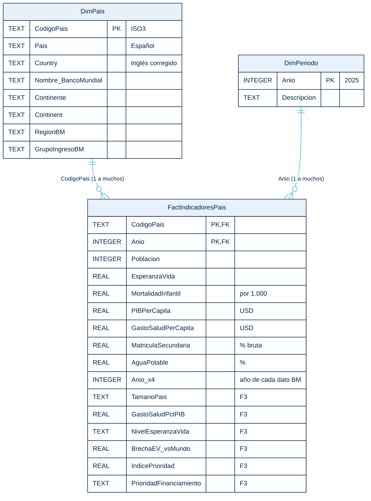

# Brechas globales de salud y longevidad

Proyecto del **Taller 02 · Business Intelligence** de la Especialización en Analítica de Datos para los Negocios (Fundación Universitaria Comfamiliar).
Es un dashboard ejecutivo interactivo sobre salud, esperanza de vida y demografía en 216 países, construido sobre un **modelo en estrella** en SQLite.

**Dashboard publicado (GitHub Pages):** `https://carmaster13.github.io/BancoMundial/`

> Proyecto académico independiente. No es un sitio ni una publicación oficial del Banco Mundial.

## Pregunta clave

¿En qué continentes y países se concentran las mayores brechas de longevidad y salud infantil, y qué factores (tamaño de población, ingreso, inversión en salud, educación y agua potable) se asocian a ellas **más allá del nivel de ingreso**, para priorizar dónde invertir el financiamiento internacional?

## Estructura del repositorio

| Carpeta | Contenido |
|---|---|
| `docs/` | `index.html`: el dashboard publicado (Observatorio Global de Salud) y el diagrama del modelo |
| `dashboard_clase/` | Versión del dashboard con la identidad del Banco Mundial para la presentación en clase (no se publica en Pages) |
| `pipeline/` | Scripts de las fases 1 a 7, la plantilla del dashboard y las librerías incluidas (`libs/`) |
| `datos/originales/` | Archivos del curso y descargas de World Development Indicators |
| `datos/modelo/` | Modelo en estrella: Excel (con TablaEquivalencias, LogCalidad y DiccionarioVariables), base SQLite y JSON del dashboard |
| `datos/resultados/` | Correlaciones, reglas de asociación y respuestas a las preguntas (Fase 5) |

## Fases

| Fase | Qué hace | Script |
|---|---|---|
| 0 | Pregunta clave y 12 KPI | — |
| 1 | Gobernanza de nombres (llave ISO3, tabla de equivalencias, corrección de MNE, MAF y SWZ) y data wrangling | `fase1_wrangling.py` |
| 2 | Integración de PIB, gasto en salud, matrícula y agua (último dato desde 2015) | incluida en la fase 1 |
| 3 | Ingeniería de características: tamaño del país, gasto en salud % PIB, nivel de esperanza de vida, brecha frente al mundo e índice de prioridad | `fase3_caracteristicas.py` |
| 4 | Modelo en estrella en SQLite con llaves, reglas CHECK y vistas SQL de los KPI | `fase4_modelo_estrella.py` |
| 5 | Correlaciones de Spearman, correlación parcial controlando el PIB, reglas de asociación (Apriori) y respuestas P1–P6 | `fase5_analisis.py` |
| 6 | Dashboard HTML interactivo con filtros cruzados | `fase6_construir_dashboard.py` |
| 7 | Versión publicable con marca neutra | `fase7_version_publicable.py` |



## Cómo regenerar todo

```bash
pip install -r requirements.txt

python pipeline/fase1_wrangling.py       datos/originales datos/modelo/Modelo_Estrella_BancoMundial.xlsx
python pipeline/fase3_caracteristicas.py datos/modelo/Modelo_Estrella_BancoMundial.xlsx
python pipeline/fase4_modelo_estrella.py datos/modelo/Modelo_Estrella_BancoMundial.xlsx datos/modelo/modelo_estrella_bm.db datos/modelo/datos_dashboard.json
python pipeline/fase5_analisis.py        datos/modelo/modelo_estrella_bm.db datos/modelo/datos_dashboard.json datos/resultados
python pipeline/fase6_construir_dashboard.py pipeline/plantilla_dashboard.html datos/modelo/datos_dashboard.json dashboard_clase/Dashboard_BancoMundial.html
python pipeline/fase7_version_publicable.py  pipeline/plantilla_dashboard.html datos/modelo/datos_dashboard.json pipeline/libs docs/index.html
```

Al cambiar los datos de `datos/originales/` y volver a correr los scripts, el modelo, los análisis y los dos dashboards se actualizan solos.

## Fuentes y notas

- Archivos del curso: población, esperanza de vida y mortalidad infantil (por 1.000 nacidos vivos; año de la fuente no registrado).
- World Development Indicators: PIB per cápita (NY.GDP.PCAP.CD), gasto en salud per cápita (SH.XPD.CHEX.PC.CD), matrícula secundaria bruta (SE.SEC.ENRR) y agua potable gestionada de forma segura (SH.H2O.SMDW.ZS).
- Los valores faltantes no se imputan. Las correlaciones y reglas muestran asociación, no causalidad.
